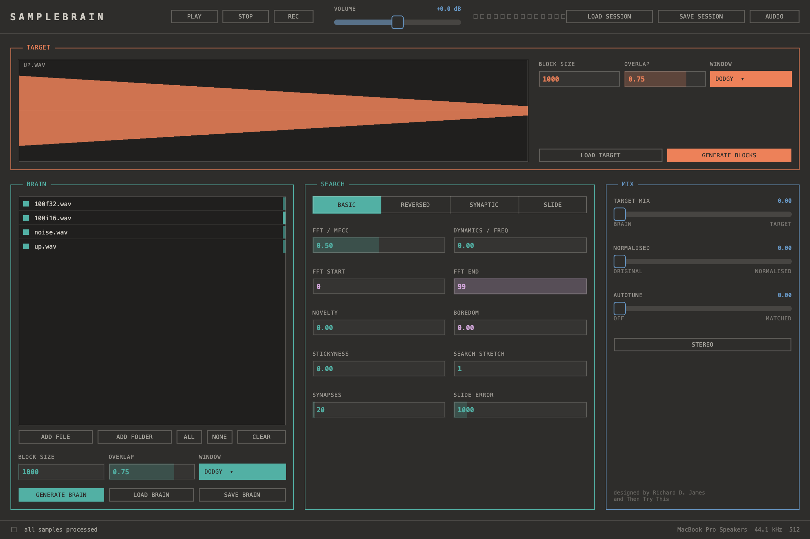

# Samplebrain

A custom sample mashing app designed by Aphex Twin.

This fork puts a new interface on the original brain engine: a JUCE app
in the Sungam graphite style (dark paper, one monospace face, hairline
panels, colour as signal: coral target, teal brain, steel output, amber for
anything live).

## Download (macOS)

**[Latest release](https://github.com/SungamMagnus/SampleBrain/releases/latest)**:
a universal app for Apple Silicon and Intel, macOS 11 or later.

The app is not notarised. The first time, right-click it and choose
**Open**, or clear the quarantine flag:

    xattr -dr com.apple.quarantine "/Applications/Samplebrain.app"

## What's different in this fork

- A new interface: target across the top with its waveform and playhead,
  then the brain, its search settings and the mix side by side.
- Drop sounds onto the brain list and a target onto the waveform. Any
  format JUCE reads loads: wav, aiff, flac, ogg, mp3.
- Every control sends its value at startup. The Qt app left the engine on
  its own defaults until a control was moved.
- Changing a block size re-sends the overlap, which the engine converts to
  samples using the block size it holds at that moment.
- Recording writes one stereo wav per take.
- Not carried over yet: sending to other machines over OSC, and mic input
  (disabled in the original too).

## Building

    cmake -S . -B build -DCMAKE_BUILD_TYPE=Release
    cmake --build build -j
    open build/Samplebrain_artefacts/Release/Samplebrain.app

Needs only JUCE (`/Applications/JUCE`, or pass `-DJUCE_DIR=...`). JUCE
replaces PortAudio and libsndfile, an in-process bus replaces liblo (same
message names), and FFTW is swapped for the vendored, header-only
pocketfft. The engine changes sit behind compile flags, so the original Qt
build (`samplebrain.pro`) is unchanged.

# About Samplebrain

Samplebrain chops samples up into a 'brain' of interconnected small
sections called blocks which are connected into a network by
similarity. It processes a target sample, chopping it up into blocks
in the same way, and tries to match each block with one in its brain
to play in realtime.

This allows you to interpret a sound with a different one. As we
worked on it (during 2015 and 2016) we gradually added more and more
tweakable parameters until it became slightly out of control.

Quick start:

1. Load a bunch of short wav files into the brain
2. Click (re)generate brain
3. Load a short loop sample into the target
4. Click (re)generate blocks
5. Press play
6. Tweak brain

The default block size (3000) is really high to prevent CPU glitches -
500 to 1000 is a better range. Larger wav files like whole tracks can
be used, but take a long time to process, after which they can be
saved as "brain" files and instantly reloaded.

# [Demo brain session](https://static.thentrythis.org/samplebrain/demo.samplebrain)

Load this file using "load session" not "load brain" (sessions contain
both the target and brain samples). The original samples used to
create the demo session [can be found here for
testing](https://static.thentrythis.org/samplebrain/samples/).

# [Manual](docs/manual.md)

Full description of all the parameters and a bit of the thinking
behind it.

# Original Qt builds (Then Try This)

As this is experimental non-commercial software (only originally
written to run on a couple of computers!) you will have to bear with
us as we gradually stabilise things based on your feedback. There
might currently be problems running it on 64bit Windows.
            
* **Windows**: [samplebrain_0.18.3_win.zip](https://static.thentrythis.org/samplebrain/samplebrain_0.18.3_win.zip)
* **Mac (intel/m1)**: [samplebrain_0.18.3_macintel.zip](https://static.thentrythis.org/samplebrain/samplebrain_0.18.3_macintel.app.zip)

(New 0.18.3 release fixes loading samples from paths longer than 255 characters)
    
Mac note: As this software is not on the apple store, to run the
binary you need to tell your mac it's ok: Go to System Preferences >
Security & Privacy > General. At the bottom of the window, select
"Allow apps to be downloaded from Anywhere".

Thank you to [Nik Gaffney](http://fo.am) for help with the Apple builds

### Linux

#### Ubuntu
    $ sudo add-apt-repository ppa:thentrythis/samplebrain
    $ sudo apt update
    $ sudo apt install samplebrain

If you'd like the right font, optionally:

    $ sudo apt install ttf-mscorefonts-installer

# Old/broken/spurious binaries

* **Windows**: [samplebrain_0.18.2_win.zip](https://static.thentrythis.org/samplebrain/samplebrain_0.18.2_win.zip)    
* **Windows**: [samplebrain_0.18.1_win.zip](https://static.thentrythis.org/samplebrain/samplebrain_0.18.1_win.zip)
* **Windows**: [samplebrain_0.18_win.zip](https://static.thentrythis.org/samplebrain/samplebrain_0.18_win.zip)

* **Mac (intel/m1)**: [samplebrain_0.18.1_macintel.zip](https://static.thentrythis.org/samplebrain/samplebrain_0.18.1_macintel.app.zip)
* **Mac (intel)**: [samplebrain_0.18_macintel.zip](https://static.thentrythis.org/samplebrain/samplebrain_0.18_macintel.zip)
* **Mac (m1)**: [samplebrain_0.18_m1_v2.dmg](https://static.thentrythis.org/samplebrain/samplebrain_0.18_m1_v2.dmg) 
                
# Building the Qt version from source
## Linux (Ubuntu)
Install libraries for the sample engine (use brew on mac, MinGW on win):

    $ sudo apt install libsndfile1-dev portaudio19-dev liblo-dev libfftw3-dev

Install dependencies for the interface:

    $ sudo apt install build-essential qtcreator qt5-default

Build & run it:

    $ mkdir build
    $ cd build
    $ qmake ..
    $ make
    $ sudo make install
    $ samplebrain

## Mac
Install libraries for sample engine:

    $ brew install fftw portaudio liblo libsndfile

Install dependencies for the interface:

    $ brew install qt
    $ brew link qt

Build & run it:

    $ mkdir build
    $ cd build
    $ qmake ..
    $ make

`samplebrain.app` should then be in the app folder for you to run.

# Mac build additions

To make a mac app bundle:

Run `macdeployqt` which copies all dependencies inside the app.

    $ cd build
    $ macdeployqt

If the icon is not visible, you might need to copy desktop/samplebrain.icns (the icon) to the Resources directory in the app bundle.

    $ cp ../desktop/samplebrain.icns samplebrain.app/Contents/Resources

Then edit Info.plist to add samplebrain.icns to CFBundleIconFile. Key `CFBundleIconFile` should match:

	<key>CFBundleIconFile</key>
	<string>samplebrain.icns</string>

You might also need to resign the app bundle after making any changes

    $ codesign --force --deep --sign - samplebrain.app

## What's here

1. brain:
    * samplebrain engine code
2. app:
    * code to build the Qt GUI app
3. gui:
    * qt designer project files
4. desktop:
    * various icon files etc
4. cooking:
    * some sketches and ideas
    * proof of concept written in python
    * brief initial (abandoned) attempt at clojure version

MFCC algo courtesy of the Aquila library by Zbigniew Siciarz MIT/X11
licence 2007-2014 (see brain/src/aquila/LICENCE)

This program is free software licenced under GNU General Public
License version 2 (see LICENCE).

Written by [Dave Griffiths at Then Try This](http://thentrythis.org).

## Links

To find related tech like [CataRT](https://ircam-ismm.github.io/max-msp/catart.html), [bbcut2](https://composerprogrammer.com/bbcut2.html), [eargram](https://sites.google.com/site/eargram/) and [sCrAmBlEd?HaCkZ!](https://www.youtube.com/watch?v=eRlhKaxcKpA) search up [granular synthesis](http://granularsynthesis.com/guide.php), [concatenative synthesis](https://hal.archives-ouvertes.fr/hal-01161337), [neural audio synthesis](https://github.com/acids-ircam/RAVE), [sinewave speech](http://www.lifesci.sussex.ac.uk/home/Chris_Darwin/SWS/), automated breakbeat cutting, audio mosaicing and plunderphonics/plundermatics.
